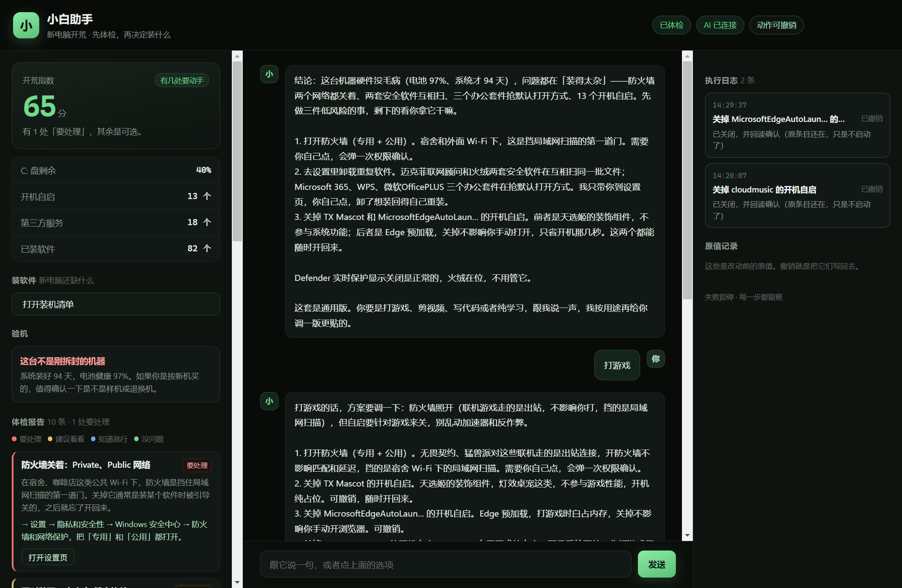
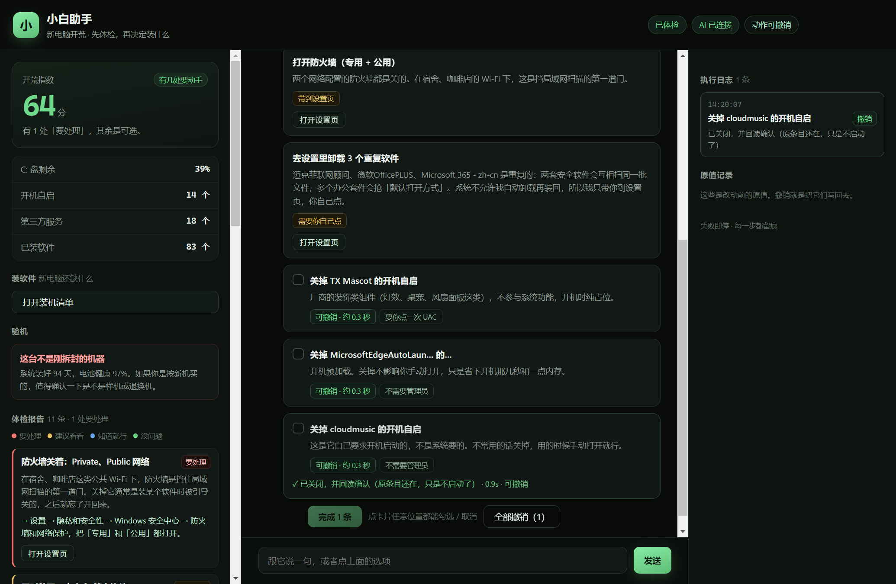
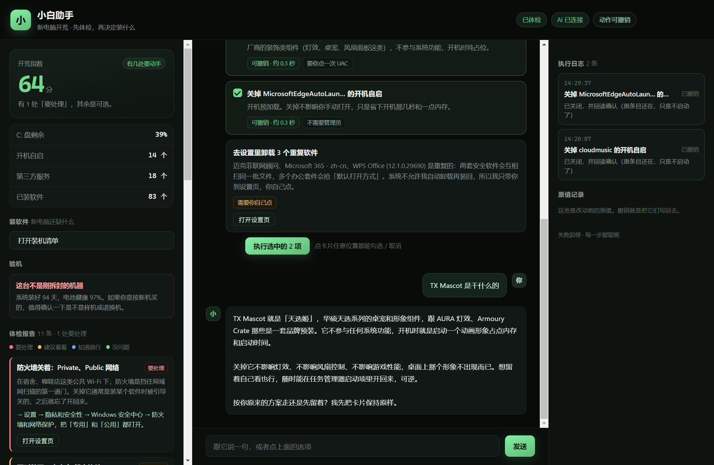

# 开机第一天

> 新电脑开荒：先体检，再决定装什么。

**v0.2 · Agent 版**：一个能真的动手、也能真的撤回的桌面程序。双击 → 20 秒体检 → 问两句（这台拿来干嘛、办公套件留哪个）→ 列出几条动作卡片 → 点执行逐条生效 → 不满意，点撤销，三秒回到原样。

卡片出来以后还能接着问：改变主意就说「留 Office」，整组卡片当场换成对应的版本；想知道某个东西是什么、能不能删，直接打字问（「迈克菲联网顾问是什么」「迈克菲能删吗」「怎么撤销」「哪些能删」），它只用这次体检的数据回答，答不上来就说不知道。点卡片任意位置都能勾选，不用非得戳那个小方块。

两步提问还没答完时，也能直接问「你是谁」「迈克菲能删吗」——它先把问题答了，再把当前这一步的问题问回来，不会把你的话当成选项吞掉。





**v0.1 · 只读版**（网页 / 105 KB 单文件）：https://ni-haoyang.github.io/kaiguang/ —— 只看不动，把机器讲明白，给一张可审阅的开荒单。

**静态交互演示**（不用下载，直接点）：https://ni-haoyang.github.io/kaiguang/docs/agent-demo.html —— 界面和动作序列与桌面版一致，执行是模拟的，不会碰你的电脑。

## 本地服务是上锁的

桌面版只监听 `127.0.0.1`，不对外开端口。每次启动生成一次性口令，随页面下发，所有 `/api/*` 请求都要带；别的网页读不到页面源码，也拿不到口令，就没法替你按「执行」。动作里的「打开设置页」在动作库这一层就被限制成 `ms-settings:`，不会变成打开任意路径。

## v0.2 桌面版怎么跑

1. 从 [Releases](https://github.com/NI-haoyang/kaiguang/releases) 下载 `kaiguang-v0.2.7-win64.zip`（约 113 MB，含 Electron 运行时，不用装 Node、不用联网）。
2. **把整个 zip 解压到一个空文件夹**，再双击文件夹里的 `开机第一天.exe`。
   - 不要只把 exe 复制出来，也不要在压缩软件里直接双击 exe —— Windows 只会把 exe 单独解到临时目录，DLL 和 resources 没跟过来，就会报「找不到 ffmpeg.dll」。
   - 不确定的话，先双击同目录的 `启动前检查.bat`，它会告诉你缺了什么。
3. 等 20 秒，窗口里自动出体检报告；在中间对话框点一个选项（或直接打字），动作卡片就出来了。之后还能接着打字追问，卡片会跟着换。
4. 勾选要做的，点「执行选中的 N 项」；想反悔，点左下角「全部撤销」。

没有 API key 也能完整跑：不填 key 时用本地规则引擎出方案，体检、执行、撤销一个不少。点右上角「本地规则 / AI 已连接」，可以填自己的 DeepSeek key，让 AI 解释每一项、回答「TX Mascot 是干什么的 / 能不能删 / 怎么退」这类追问（key 只存在本机 `%LOCALAPPDATA%\Kaiguang\settings.json`，不上传）。

### AI 是可选增强，不是运行前提

- **不填 key**：规则引擎照常出方案，体检、执行、撤销一个不少；追问由本地知识库回答。
- **填了 key**：追问交给 DeepSeek，能结合这台机器的真实数据和内置知识库解释「这是什么、关掉会怎样、能不能退」。
- **模型不碰执行**：动作清单由规则引擎挑，模型只输出纯文本解释；断网、key 失效、额度用完都会静默回落到本地规则。

公开仓库与 Release 里**不含任何 key**。如果评委机不方便自己填，可以在本地用 `tools/build-private.ps1 -Key <key>` 生成一个内置限额 key 的演示包（`app/lib/builtin-key.mjs` 已 gitignore），只发给现场，不公开上传。



**它是怎么做到「敢按下去」的**

| 层 | 做法 | 效果 |
|---|---|---|
| AI 只解释，不碰执行 | 动作清单由规则引擎按体检结果挑；模型只读摘要、输出纯文本，不产出命令也不产出动作 | 模型说错最多是解释不准，不会误操作 |
| 执行前先留退路 | 改之前把原值写进 journal（注册表二进制、软件包 ID、服务启动类型） | 撤销 = 把原值写回去，不需要重装 |
| 失败即停 + 全程留痕 | 任何一步失败，后面不再执行；日志逐条可导出 | 评委可以查它做了什么、为什么、怎么退 |

主动不做的：不卸驱动、不改 BIOS、不碰分区、不删系统组件；改服务启动类型、开防火墙这类需要管理员的事不代劳，只把你带到设置页，最后一下你自己点。

## 目录（v0.1 只读版）

## 目录

| 文件 | 作用 |
|---|---|
| **`双击我.bat`** | **一条命令都不用敲：双击 → 采集 → 桌面直接出现一份 html 报告并打开** |
| **`一键运行.bat`** | **有 Node.js 时的另一条路：采集完自动开浏览器，报告直接显示** |
| `start.mjs` | 上面那个 bat 背后做的事：占端口 → 跑 `collect.ps1` → 把数据注入页面 → 开浏览器 |
| **`exe/`** | **编译成 exe 的全部源码：`KaiguangApp.cs`（WinForms 壳 + 内嵌资源 + 微型 HTTP 服务）+ `build-exe.ps1`（用 Windows 自带的 csc 编译，产物 105 KB）** |
| `打开网页.bat` | 只打开网页看看（断网、没有 Node 也能用） |
| `启动服务.bat` | 想用「AI 深读」时才需要（要 Node.js 和 API key） |
| `make-report.ps1` | 把 `report.json` 和网页模板焊成一个独立 html（不联网） |
| `collect.ps1` | 只读采集，输出 `report.json`（不写注册表、不装软件、不联网） |
| `index.html` | 单页应用：拖入 report.json → 体检报告 → 开荒单 → 可审阅脚本 |
| `rules.js` | 规则库：同类软件分组、厂商分组、常见软件的「它是干嘛的」 |
| `app.js` | 分析与渲染逻辑（纯前端，无框架、无构建） |
| `sample.js` | 一台真机（ASUS 天选 / Win11，已用 79 天）的示例数据 |
| `sample-new.js` | 模拟「刚开箱」的同一台机器（只留整机厂组件），用来演示全新机路径 |
| `server.mjs` | 可选：静态服务器 + `/api/analyze`（接 LLM 的「AI 深读」） |
| `docs/一页纸方案.md` | 报名材料 |
| `docs/路演脚本.md` | 90 秒 / 3 分钟讲稿 + 追问准备 |

## 怎么跑（给同学的版本）

0. 下载[开荒工具包](https://github.com/NI-haoyang/kaiguang/releases/download/v0.1/kaiguang-kit-v0.1.zip)（39 KB），解压
1. 双击 `双击我.bat`
2. 等 30 秒，桌面出现 `我的电脑体检报告-日期.html`
3. 双击那个 html 就能看。可以发微信、拷 U 盘、断网打开——它是独立的一个文件。

装了 Node.js 的话还有一条更省事的路：**双击 `一键运行.bat`**，采集完浏览器自己弹出来，报告已经显示好了。

全程不需要联网，不需要装任何东西。绝大多数动作不需要管理员——只有整机级（HKLM）的开机自启会弹一次 UAC，你点「是」它才动，点「否」就当没发生。

## 编译成 exe（105 KB，双击即用）

不想要文件夹、不想要 Node、不想要 bat：一个 exe 全包了。它把 index.html / style.css / rules.js / app.js / collect.ps1 全部嵌进自己里面，跑的时候解到临时目录，开一个只监听 127.0.0.1 的小服务，跑完把浏览器叫出来。

    powershell -NoProfile -ExecutionPolicy Bypass -File .\exe\build-exe.ps1

产物在 `dist\开机第一天.exe`。不需要装 Visual Studio、不需要 .NET SDK——用的是系统里自带的 .NET Framework 4.8 编译器（Win10 1903 以后都有）。

- **105 KB**：做参照，同样功能打 Electron 约 100 MB，Tauri 约 5 MB，Go + embed 约 7 MB。
- 为什么这么小：.NET Framework 4.8 是系统组件，不跟着 exe 走；程序本体只有 ~15 KB 的 IL，剩下 90 KB 是内嵌的网页。
- 代价：只能跑在 Windows 上（本来也只是 Windows 工具），首次运行可能被 SmartScreen 拦一次（没有代码签名）。

## 怎么跑（开发版）

**只用页面（最简单）**

1. PowerShell 里跑采集：
   ```powershell
   powershell -NoProfile -ExecutionPolicy Bypass -File .\collect.ps1
   ```
2. 双击 `index.html`（直接用 file:// 打开就行）。
3. 把生成的 `report.json` 拖进页面。
   没有报告？点「载入示例」，用的是这台天选的真实数据。

**带本地服务（可演示 AI 深读）**

```bash
node server.mjs            # http://127.0.0.1:4173/?demo=1
```

设置 `DEEPSEEK_API_KEY` 才会启用 `/api/analyze`；不设置时页面会退回本地建议，其它功能不受影响。

## 隐私

- 采集脚本只读取信息，源码里没有任何 `Set-Item` / `Remove-Item` / `New-Item` 之类的写入动作。
- 用户名会被替换成 `*`，不采集 MAC、不采集文件内容、不采集浏览器历史。
- 所有分析在浏览器本地完成。只有你主动点「AI 深读」，才会把报告摘要发出去。

## 已知边界

- 只支持 Windows 10/11（采集脚本依赖 WMI/CIM 与注册表）。
- 规则是「可解释的启发式」，不是杀毒引擎：它判的是「该不该整理」，不是「安不安全」。
- `report.json` 里的软件列表按注册表 Uninstall 键统计，绿色版/便携软件可能统计不到。

## 30 秒录制清单（报名 Demo）

1. 开 PowerShell，跑 `collect.ps1`，让「只读」「采集完成」两行出现在画面里。
2. 把 `report.json` 拖进网页，停在开荒指数和第一张红色卡片上。
3. 念一句卡片上的解释：「Defender 显示关闭是正常的，你装了火绒，它让位了，不是中毒。」
4. 滚到脚本区，指着满屏的 `#` 说：「这些我都不会替你执行。」
5. 切一下档位，让开荒单变一次，收尾。